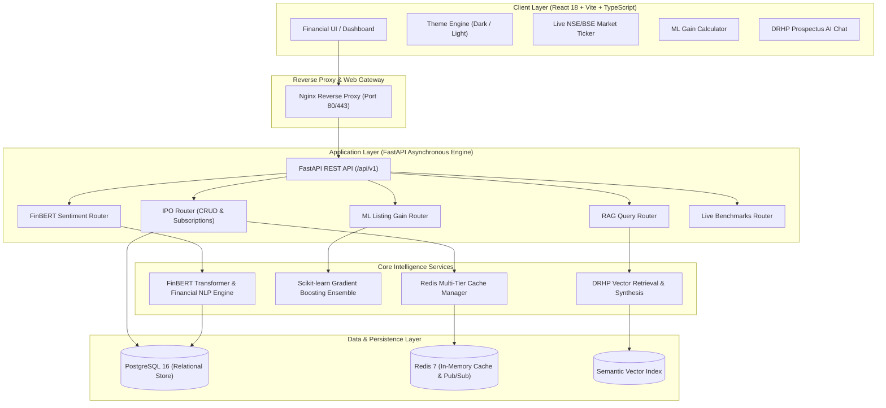
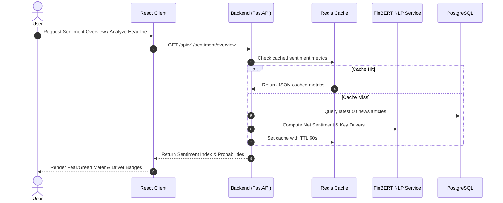
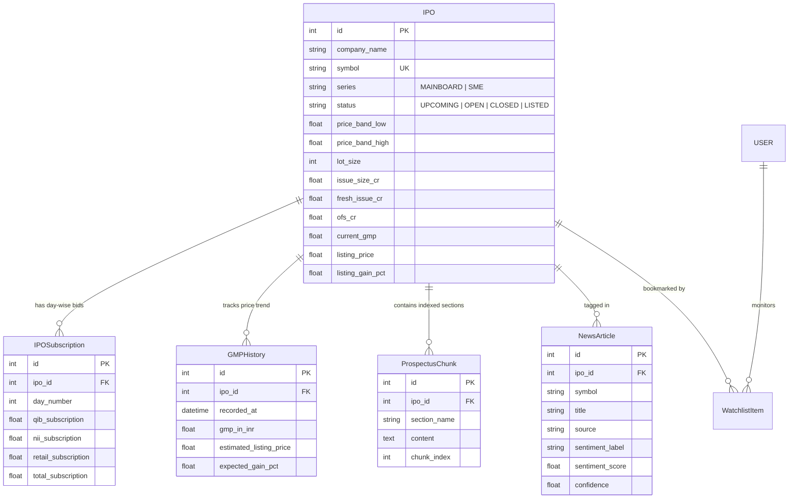

# System Architecture: IPO Analysis & Stock Sentiment Analyzer (NSE/BSE)

## 1. Executive Summary

The **IPO Analysis & Stock Sentiment Analyzer** is an enterprise-grade financial intelligence platform tailored specifically to the Indian capital markets (NSE & BSE). It provides retail and institutional investors with real-time grey market premium (GMP) tracking, subscription momentum analytics across investor buckets (QIB, NII, Retail), FinBERT-powered sentiment classification, RAG-driven SEBI Draft Red Herring Prospectus (DRHP) exploration, and machine learning listing-day gain forecasting.

---

## 2. High-Level Component Architecture

---

## 3. Data Flow & Communication Lifecycle

### 3.1. IPO Ingestion & Live GMP Ingestion
1. **Source Feeds**: SEBI filings, NSE/BSE corporate announcements, and merchant banker updates.
2. **Persistence**: Relational schema records price band, issue sizes (Fresh vs. OFS), registrar, and timelines.
3. **Caching**: Live GMP and subscription ratios are cached in Redis with a 60-second TTL to handle high-traffic listing day traffic surges.

### 3.2. FinBERT Sentiment Pipeline

### 3.3. DRHP RAG (Retrieval-Augmented Generation) Pipeline
1. **Document Ingestion**: SEBI DRHP / RHP PDF documents are pre-processed and segmented into distinct semantic sections (*Risk Factors*, *Objects of the Issue*, *Financial Indebtedness*, *Promoter Track Record*).
2. **Query Processing**: User submits natural-language questions (e.g. *"What are the litigation risks against promoters?"*).
3. **Vector Retrieval**: Semantic similarity matching isolates the top-k highest-scoring prospectus chunks.
4. **Context Synthesis**: Generates accurate, cited summaries with explicit page and statutory section tags.

---

## 4. Database Schema Entity-Relationship (ER) Model

---

## 5. Security & High Availability Standards

- **Cross-Origin Resource Sharing (CORS)**: Strict origin validation allowing only authorized frontend domains.
- **Database Connection Pooling**: SQLAlchemy async engine utilizes connection health pinging (`pool_pre_ping=True`) with a 10-pool / 20-overflow ceiling.
- **Graceful Fallbacks**: In-memory LRU fallback ensures unbroken uptime if Redis or remote HuggingFace weights are momentarily unreachable.
- **Statutory Disclaimers**: SEBI-compliant analytical disclaimers rendered across all user interfaces.

